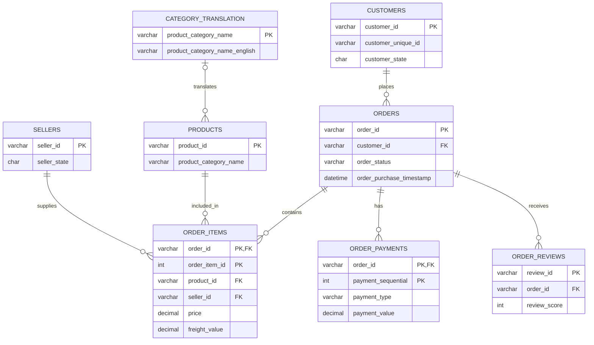
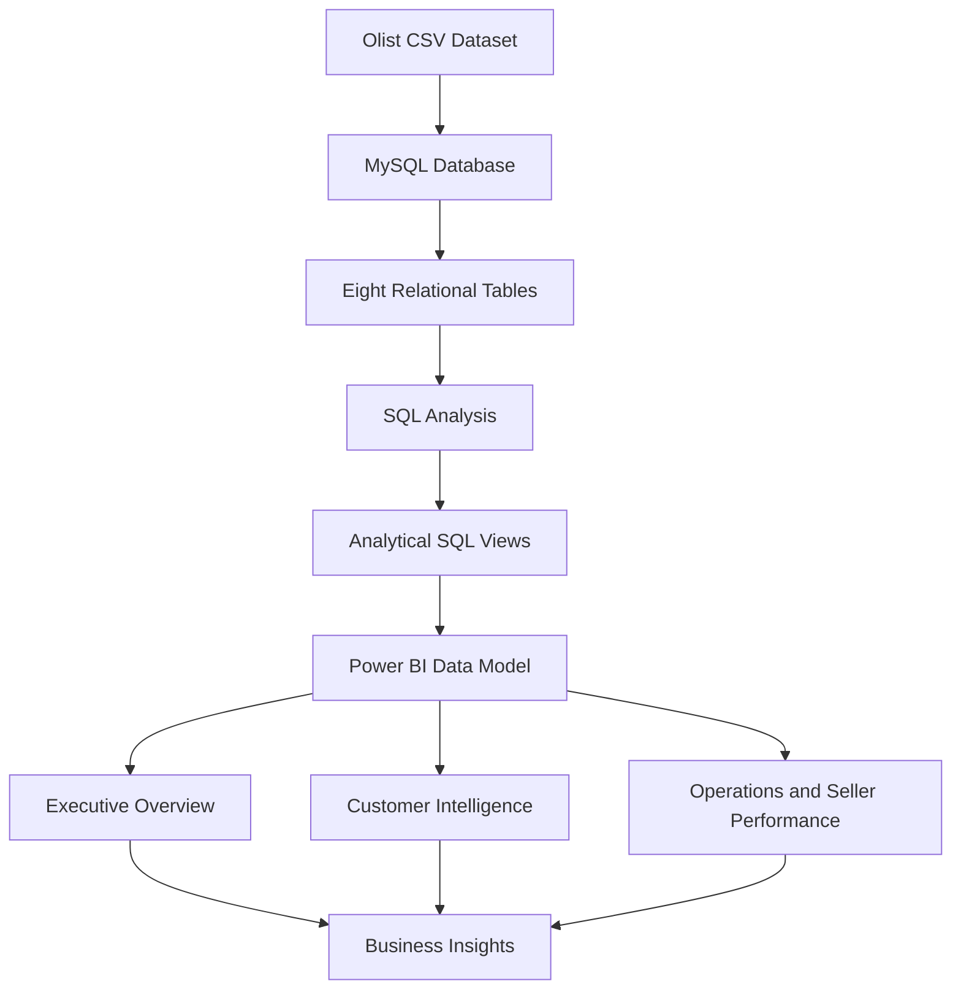

# 🗄️ Data Model – Brazilian E-Commerce Analytics

## 1. Introduction

The Brazilian E-Commerce Analytics project uses a relational database developed in MySQL to store and analyse Brazilian e-commerce transaction data.

The database is named:

`olist_ecommerce`

The database contains eight core relational tables connected through primary keys and foreign keys.

The data model supports analysis of:
- Customers
- Sellers
- Products
- Orders
- Payments
- Reviews
- Product categories
- Delivery operations

## 2. Database Tables

### 2.1 Customers

**Table:** `customers`

Stores customer identification and geographical information.

| Column | Data Type | Key |
|---|---|---|
| customer_id | VARCHAR(32) | Primary Key |
| customer_unique_id | VARCHAR(32) | — |
| customer_zip_code_prefix | CHAR(5) | — |
| customer_city | VARCHAR(100) | — |
| customer_state | CHAR(2) | — |

**Purpose:** Stores customer records and supports geographical and customer-level analysis.

### 2.2 Sellers

**Table:** `sellers`

Stores seller identification and location information.

| Column | Data Type | Key |
|---|---|---|
| seller_id | VARCHAR(32) | Primary Key |
| seller_zip_code_prefix | CHAR(5) | — |
| seller_city | VARCHAR(100) | — |
| seller_state | CHAR(2) | — |

**Purpose:** Supports seller performance and geographical revenue analysis.

### 2.3 Products

**Table:** `products`

Stores product information and physical attributes.

| Column | Data Type | Key |
|---|---|---|
| product_id | VARCHAR(32) | Primary Key |
| product_category_name | VARCHAR(100) | — |
| product_name_length | INT | — |
| product_description_length | INT | — |
| product_photos_qty | INT | — |
| product_weight_g | INT | — |
| product_length_cm | INT | — |
| product_height_cm | INT | — |
| product_width_cm | INT | — |

**Purpose:** Supports product and category performance analysis.

### 2.4 Category Translation

**Table:** `category_translation`

Stores English translations of Portuguese product category names.

| Column | Data Type | Key |
|---|---|---|
| product_category_name | VARCHAR(100) | Primary Key |
| product_category_name_english | VARCHAR(100) | — |

**Purpose:** Makes product category analysis easier to understand.

### 2.5 Orders

**Table:** `orders`

Stores order information and important timestamps.

| Column | Data Type | Key |
|---|---|---|
| order_id | VARCHAR(32) | Primary Key |
| customer_id | VARCHAR(32) | Foreign Key |
| order_status | VARCHAR(30) | — |
| order_purchase_timestamp | DATETIME | — |
| order_approved_at | DATETIME | — |
| order_delivered_carrier_date | DATETIME | — |
| order_delivered_customer_date | DATETIME | — |
| order_estimated_delivery_date | DATETIME | — |

**Purpose:** Tracks order status, purchase dates and delivery performance.

### 2.6 Order Items

**Table:** `order_items`

Stores individual products included in each order.

| Column | Data Type | Key |
|---|---|---|
| order_id | VARCHAR(32) | Composite Primary Key / Foreign Key |
| order_item_id | INT | Composite Primary Key |
| product_id | VARCHAR(32) | Foreign Key |
| seller_id | VARCHAR(32) | Foreign Key |
| shipping_limit_date | DATETIME | — |
| price | DECIMAL(10,2) | — |
| freight_value | DECIMAL(10,2) | — |

**Purpose:** Connects orders with products and sellers and supports product revenue analysis.

### 2.7 Order Payments

**Table:** `order_payments`

Stores payment information associated with orders.

| Column | Data Type | Key |
|---|---|---|
| order_id | VARCHAR(32) | Composite Primary Key / Foreign Key |
| payment_sequential | INT | Composite Primary Key |
| payment_type | VARCHAR(30) | — |
| payment_installments | INT | — |
| payment_value | DECIMAL(10,2) | — |

**Purpose:** Supports payment method and transaction analysis.

### 2.8 Order Reviews

**Table:** `order_reviews`

Stores customer feedback and review information.

| Column | Data Type | Key |
|---|---|---|
| review_id | VARCHAR(32) | Composite Primary Key |
| order_id | VARCHAR(32) | Composite Primary Key / Foreign Key |
| review_score | INT | — |
| review_comment_title | TEXT | — |
| review_comment_message | TEXT | — |
| review_creation_date | DATETIME | — |
| review_answer_timestamp | DATETIME | — |

**Purpose:** Supports customer satisfaction and review score analysis.

---

## 3. Primary Key and Foreign Key Relationships

The database uses the following relationships.

| Parent Table | Parent Key | Child Table | Foreign Key |
|---|---|---|---|
| customers | customer_id | orders | customer_id |
| orders | order_id | order_items | order_id |
| products | product_id | order_items | product_id |
| sellers | seller_id | order_items | seller_id |
| orders | order_id | order_payments | order_id |
| orders | order_id | order_reviews | order_id |

The `order_items` table uses a composite primary key consisting of `order_id` and `order_item_id`.

The `order_payments` table uses `order_id` and `payment_sequential` as its composite primary key.

The `order_reviews` table uses `review_id` and `order_id` as its composite primary key.

## 4. Entity Relationship Diagram

The following diagram represents the core database structure.

## 5. Database Design Explanation

The database follows a relational structure.

- Customers are connected to orders through `customer_id`.
- Orders are connected to order items through `order_id`.
- Order items connect products and sellers.
- Orders connect payment records and customer reviews.
- Product categories are connected to their English translations through category names.

This structure reduces unnecessary duplication and supports flexible SQL queries across different business entities.

## 6. Power BI Data Model

The MySQL database supplies the analytical data used in Power BI.

The Power BI report contains three major analytical sections.

### Executive Overview

Uses sales and product-related analytical views to analyse:
- Order volume
- Product revenue
- Monthly revenue
- Product category performance

### Customer Intelligence

Uses customer-level analytical data and RFM segmentation to analyse:
- Unique customers
- Repeat customers
- Repeat customer rate
- Average customer spending
- Customer segments

### Operations & Seller Performance

Uses seller, delivery and review analytical views to analyse:
- Delivered orders
- Average delivery days
- Late delivery percentage
- Seller revenue
- Customer review scores

### Additional Power BI Relationships

The Operations dashboard uses `vw_seller_state_dimension` as a state lookup table connected to:

- `vw_delivery_performance_by_seller_state`
- `vw_review_details_by_seller_state`

These relationships support dynamic Seller State filtering.

## 7. Data Flow Architecture

## 8. Conclusion

The relational database provides a structured foundation for the Brazilian E-Commerce Analytics project.

By connecting customer, order, product, seller, payment and review information, the database supports a wide range of business queries.

The analytical views and Power BI data model transform the relational data into interactive dashboards for business intelligence and decision-making.

---

*Database schema documented from the MySQL table creation script. Additional analytical views and Power BI relationships are documented separately from the core eight-table schema.*
