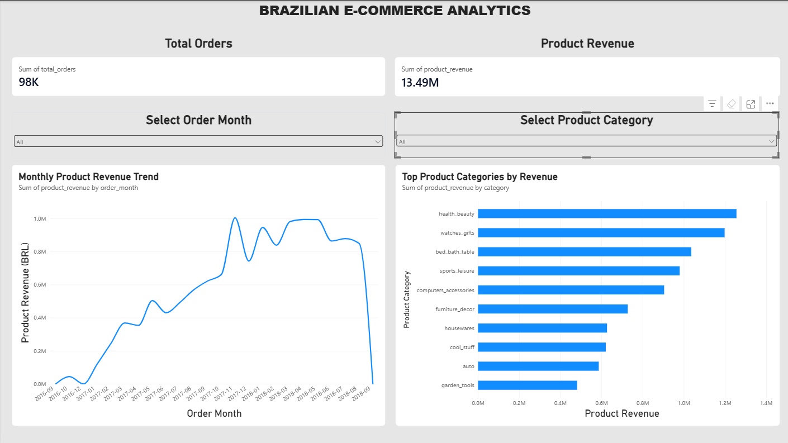
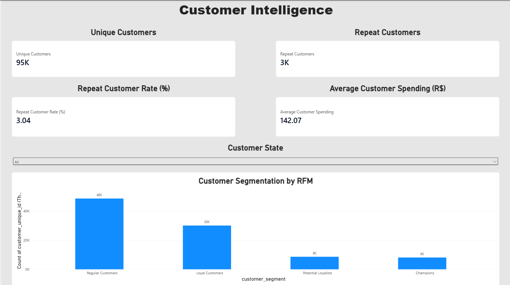
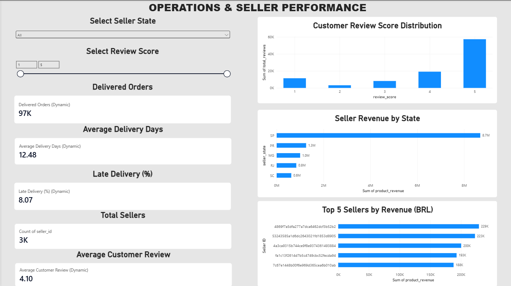

# 🇧🇷 Brazilian E-Commerce Analytics

### End-to-End SQL & Power BI Business Intelligence Project

An end-to-end data analytics project using the Brazilian E-Commerce Public Dataset by Olist, combining MySQL, SQL and Microsoft Power BI to analyse sales, customers, products, sellers, delivery operations and customer satisfaction.

## 📊 Project Overview

This project transforms raw Brazilian e-commerce transaction data into business insights through relational database design, SQL-based analytics, analytical views and interactive Power BI dashboards.

**Project workflow:**

`Raw Data → MySQL Database → SQL Analysis → Analytical Views → Power BI → Business Insights`

## 🛠️ Tech Stack

| Technology | Application |
|---|---|
| MySQL 8.0 | Relational database |
| SQL | Data extraction, cleaning and analysis |
| MySQL Workbench | Database development |
| Microsoft Power BI | Interactive dashboards |
| DAX | Dynamic KPI calculations |
| Git & GitHub | Version control and documentation |

## 📁 Repository Structure

```text
brazilian-ecommerce-analytics/
│
├── sql/
│   ├── 01_database_setup.sql
│   ├── 02_create_tables.sql
│   ├── 03_data_loading.sql
│   ├── 04_data_quality_checks.sql
│   ├── 05_basic_analysis.sql
│   ├── 06_advanced_analysis.sql
│   ├── 07_customer_analysis.sql
│   ├── 08_powerbi_filterable_views.sql
│   ├── 08_rfm_customer_segmentation.sql
│   ├── 09_analytics_views.sql
│   ├── 10_customer_dashboard_metrics.sql
│   ├── 11_rfm_dashboard_view.sql
│   ├── 12_rfm_segment_summary.sql
│   ├── 13_operations_seller_analysis.sql
│   ├── 14_review_performance.sql
│   └── 15_review_score_distribution.sql
│
├── PowerBI/
│   └── Brazilian_Ecommerce_Analytics.pbix
│
├── screenshots/
│   ├── executive_overview.png
│   ├── customer_intelligence.png
│   └── operations_seller_performance.png
│
├── Documentation/
│   └── business_insights.md
│
├── .gitignore
└── README.md
```

## 🗄️ Database Design

Database: `olist_ecommerce`

The relational database contains eight core tables:

1. customers
2. sellers
3. products
4. category_translation
5. orders
6. order_items
7. order_payments
8. order_reviews

Primary keys, foreign keys and joins connect the entities to support business analysis.

## 📈 Power BI Dashboards

### 1. Executive Overview

**Objective:** Understand overall business and product sales performance.

Features:
- Total Orders
- Product Revenue
- Monthly Product Revenue Trend
- Top Product Categories by Revenue
- Order Month slicer
- Product Category slicer



### 2. Customer Intelligence

**Objective:** Understand purchasing patterns, customer retention and customer value.

Features:
- Unique Customers
- Repeat Customers
- Repeat Customer Rate
- Average Customer Spending
- RFM Customer Segmentation
- Customer State slicer



### 3. Operations & Seller Performance

**Objective:** Evaluate operational efficiency, seller performance and customer satisfaction.

Features:
- Delivered Orders
- Average Delivery Days
- Late Delivery Percentage
- Total Sellers
- Average Customer Review
- Top Sellers by Revenue
- Seller Revenue by State
- Customer Review Score Distribution
- Seller State and Review Score slicers



## 🔍 Key Business Questions

- How does product revenue change over time?
- Which product categories generate the most revenue?
- How many customers make repeat purchases?
- Which customer segments have the highest value?
- Which Brazilian states generate the highest seller revenue?
- How efficiently are orders delivered?
- What is the distribution of customer review scores?
- Which sellers contribute the most product revenue?

## 🧠 Analytical Techniques

- SQL joins and aggregations
- Common Table Expressions (CTEs)
- Subqueries
- Conditional logic using CASE
- Date and time functions
- Window functions
- RFM customer segmentation
- Data modelling and relationships
- DAX measures
- Interactive slicers and cross-filtering

## ⚙️ How to Run

### Prerequisites

- MySQL Server 8.0
- MySQL Workbench
- Microsoft Power BI Desktop
- Brazilian E-Commerce Public Dataset by Olist

### 1. Download the dataset

[Olist Brazilian E-Commerce Dataset – Kaggle](https://www.kaggle.com/datasets/olistbr/brazilian-ecommerce)

Download and extract the CSV files locally.

### 2. Set up the database

Execute:

`sql/01_database_setup.sql`

### 3. Create tables

Execute:

`sql/02_create_tables.sql`

### 4. Load data

Configure the MySQL import directory and execute:

`sql/03_data_loading.sql`

Update file paths to match your local environment.

### 5. Perform data-quality checks

Execute:

`sql/04_data_quality_checks.sql`

### 6. Run analytics scripts

Execute the analytical SQL scripts in the `sql/` directory according to their dependencies.

The RFM, dashboard metrics and Power BI filterable views are additional reporting components.

### 7. Open the dashboard

Open:

`PowerBI/Brazilian_Ecommerce_Analytics.pbix`

Configure the MySQL connection and refresh the data if required.

## 📌 Important Business Metrics

The dashboard includes these measures:

| Metric | Description |
|---|---|
| Total Orders | Number of orders |
| Product Revenue | Revenue from product items |
| Unique Customers | Distinct customer identities |
| Repeat Customer Rate | Repeat customers as a percentage of unique customers |
| Average Customer Spending | Average product-item spending per customer |
| Average Delivery Days | Average order delivery duration |
| Late Delivery Rate | Percentage of delivered orders delivered after the estimated date |
| Average Review Score | Mean customer review score out of 5 |

Values in the interactive dashboards depend on the selected filters.

## 🚀 Project Outcomes

- Designed and populated a relational MySQL database.
- Developed SQL queries for business-oriented analysis.
- Created reusable analytical views.
- Implemented customer RFM segmentation.
- Built three interactive Power BI report pages.
- Developed dynamic DAX measures.
- Implemented state-based and review-score filtering.
- Analysed revenue, customer behaviour and operational performance.

## 📚 Data Source

Brazilian E-Commerce Public Dataset by Olist.

[Kaggle Dataset](https://www.kaggle.com/datasets/olistbr/brazilian-ecommerce)

The dataset covers Brazilian marketplace transactions from 2016–2018. Refer to the original dataset page for attribution and terms of use.

## 👨‍💻 Author

**N K Vagish**

Third-year Artificial Intelligence and Machine Learning Student

Interests: Data Analytics, SQL, Business Intelligence, Python and Machine Learning.

- GitHub: [@nkvagish18](https://github.com/nkvagish18)
- Project: [Brazilian E-Commerce Analytics](https://github.com/nkvagish18/brazilian-ecommerce-analytics)

---

*Built as a practical end-to-end Data Analytics and Business Intelligence portfolio project.*
